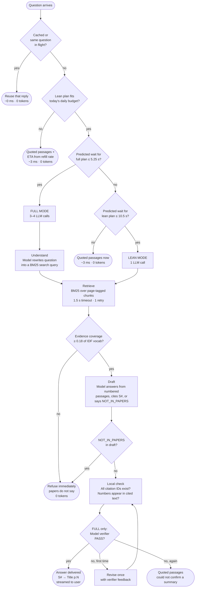

<div align="center">

# 📡 The Relay

**A production-grade agentic research assistant that never guesses.**

*Every claim is cited. Every answer is verified before you see it.*  
*When the API rate-limits — you still get a reply, in milliseconds.*

[](https://www.python.org/)
[](https://groq.com)
[](#-retrieval--correctness)
[](#️-configuration)
[](#-results)

</div>

---

## ✨ What it does

The Relay is a question-answering pipeline over research papers — or **any folder of PDFs, text files, and markdown**. Given a question, it runs an agentic chain of up to four LLM calls: query rewriting, retrieval, drafting, and model verification. The key constraint: **nothing reaches the user until it has passed all the checks for its mode.** First token = verified answer.

Before spending a single token, the system predicts how long the entire request will wait under the current rate-limit budget. It picks the richest reply mode that fits within the caller's patience, and falls back gracefully all the way to zero-cost quoted passages (~3 ms, 0 tokens) if the model is unavailable or the daily budget is gone.

```
$ python -m relay.ask "How many warmup steps does the Transformer use?"

The Transformer uses 4,000 warmup steps [Attention Is All You Need, p.7].
Sources:
  ↳ Attention Is All You Need, p.7: "We varied the learning rate over training,
    increasing it linearly for the first 4000 steps..."

[answered/full] first-token 1,053 ms · 2,761+122 tokens · 0 retries · 0 rate-limits
```

**Three reply modes, chosen automatically before any quota is spent:**

| Mode | What you get | LLM calls | Typical tokens |
|---|---|---|---|
| `full` | Written answer · locally checked · model-verified | 3–4 | ~2,000 |
| `lean` | Written answer · locally checked · marked *Quick mode* | 1 | ~550 |
| `passages` | Most-relevant sentences quoted verbatim with page citations | 0 | 0 |

Under sustained 10× overload, 60/60 requests got a reply within 15 seconds. 0 were given up. 0 were wrong. The mix was 5 full, 8 lean, 47 passages.

---

## 🏆 Results

> All numbers come from the **real Groq API** (`qwen/qwen3.8-27b`, free tier). Raw request logs are in `raw/`. Full tables are in [`tables.md`](tables.md) and [`results.csv`](results.csv).

### Correctness — 21 evaluation questions per run

The evaluation set has 14 answerable questions (spanning all three papers, some tricky) and 7 questions the papers genuinely do not answer (carbon footprint, training hardware cost, etc.).

| Retrieval setting | Correct & cited | Wrong | Correctly refused | Tokens / answer |
|---|---|---|---|---|
| 500 ch · 6 pieces · full mode | 52.4 % | 14.3 % | 33.3 % | 1,540 |
| 500 ch · 6 pieces · lean mode | 57.1 % | 9.5 % | 33.3 % | 928 |
| 900 ch · 4 pieces · rerank · lean | 57.1 % | 9.5 % | 33.3 % | 1,045 |
| **1,500 ch · 3 pieces · rerank · lean** | **61.9 %** | **4.8 %** | 33.3 % | 1,221 |
| 500 ch · 3 pieces · lean (minimal) | 57.1 % | 9.5 % | 33.3 % | 543 |

🔒 **7/7 unanswerable questions refused in every real run** — in every retrieval setting, every time.

The model verifier (full mode) did not improve over lean in Table 3; it is kept because it is the only check that reads for meaning, but its evidence for removal is noted in [`devdocs/DECISIONS.md`](devdocs/DECISIONS.md#d11).

### Load & latency — Table 2a

| Scenario | Backend | Requests | TTFT p50 / p95 / p99 | Total p50 / p95 / p99 | 100 % replied |
|---|---|---|---|---|---|
| Steady 3 req/min | **Real Groq** | 12 | 1,675 / 4,693 / 6,317 ms | 1,675 / 4,693 / 6,317 ms | ✅ |
| Burst 200 req/min | **Real Groq** | 10 | 3 / 363 / 425 ms | 3 / 363 / 425 ms | ✅ |
| Steady 3 req/min | Stand-in | 10 | 1,800 / 2,866 / 3,058 ms | 1,800 / 2,866 / 3,058 ms | ✅ |
| Burst 300 req/min | Stand-in | 40 | 3 / 1,319 / 1,833 ms | 3 / 1,319 / 1,833 ms | ✅ |
| Sustained **10× capacity** | Stand-in | 60 | 4 / 6,100 / 7,575 ms | 4 / 6,100 / 7,575 ms | ✅ |
| RPM halved mid-run | Stand-in | 20 | 3 / 2,361 / 3,370 ms | 3 / 2,361 / 3,370 ms | ✅ |
| Daily budget exhausted | Stand-in | 20 | 3 / 63 / 949 ms | 3 / 63 / 949 ms | ✅ |

**0 % given up across every scenario.**

### Outcomes — Table 2b

| Scenario | Succeeded | Rate-limited | Retries/req | Peak queue | Tokens/ans | Cost / 1K answers |
|---|---|---|---|---|---|---|
| Steady real | 100 % | 0 % | 0.17 | 1 | 2,073 | \$2.04 |
| Burst real | 100 % | 10 % | 0.00 | 1 | 41 | \$0.06 |
| Steady stand-in | 100 % | 30 % | 0.20 | 1 | 1,988 | \$1.98 |
| Burst stand-in | 100 % | 0 % | 0.00 | 1 | 175 | \$0.17 |
| Sustained overload | 100 % | 8.3 % | 0.13 | 3 | 225 | \$0.24 |
| RPM halved | 100 % | 0 % | 0.00 | 1 | 340 | \$0.36 |
| Daily exhausted | 100 % | 0 % | 0.00 | 1 | 120 | \$0.12 |

### Retry efficiency — same load, same 13 model calls served

| Policy | HTTP attempts | 429s triggered | Retries refused | p50 total |
|---|---|---|---|---|
| Naive retry (no admission control) | 239 | 225 | — | 9,094 ms |
| **The Relay (bounded retry)** | **15** | **1** | 0 | **4 ms** |

**16× fewer HTTP round-trips. 225× fewer provider-side 429s.**

### Provider limits discovered (Table 1)

| Limit | Value | How found | Confidence |
|---|---|---|---|
| Requests per minute | 30 (sliding window) | 45 rapid requests; 429 at #31 | High |
| Tokens per minute | 8,000 (header) + **7,000 input-only cap** (hidden) | 3 × 1,930-token prompts in 1 s triggered ITPM 429 | High |
| Requests per day | 1,000, refills ~1/86.4 s continuously | `x-ratelimit-reset-requests` grew 86.4 s per request | High |
| Tokens per day | 200,000, refills ~2.31 tok/s continuously | Hit for real in `burst_real`; "try again in 4m34.752s" matches formula | High |
| Concurrent requests | ≥ 12; upper bound not found | Waves of 2/4/8/12 all returned 200 | Medium |

The **7,000 input-tokens/min cap appears in no Groq documentation or rate-limit header**. It surfaced only in a 429 body. The limiter learns it and all other limits from live responses.

---

## ⚡ Quick start

> Requires Python 3.12.

```bash
pip install -r requirements.txt
cp .env.example .env        # paste your GROQ_API_KEY inside
python -m relay.ask "What attention mechanism does the Transformer use?"
```

**Use your own documents** (PDF, TXT, MD — any mix, no pre-processing needed):
```bash
python -m relay.ask --corpus path/to/folder "your question"
```

An optional `library.json` in the folder sets human-friendly display titles and aliases:
```json
{
  "arxiv_1706.03762v7.pdf": {"title": "Attention Is All You Need", "aliases": ["transformer", "vaswani"]}
}
```

**Persist daily counters across restarts** (so you don't re-spend your budget):
```bash
python -m relay.ask --limits-file state.json "your question"
```

**Use any OpenAI-compatible provider instead of Groq:**
```bash
RELAY_BASE_URL=https://your-provider/v1 \
RELAY_API_KEY=sk-... \
RELAY_MODEL=your-model-name \
python -m relay.ask "your question"
```

---

## 🔄 How a request flows



Every model call failure — 429 with no time left, timeout, server error, stall — leads to the quoted-passages reply for that request. It **never** leads to an unchecked draft reaching the user.

---

## 🧠 What makes it different

<details>
<summary><b>🎯 Backpressure-aware mode selection</b></summary>

Before spending a single token, the limiter predicts wait time for the _entire_ request plan (all LLM calls combined). It picks the richest mode that fits within the caller's patience budget — not "try full and fall back on failure". The fallback approach lets every request start its first call, then all of them compete for second calls, so nobody finishes. Whole-plan reservation avoids that entirely.

**Evidence:** sustained_overload (30 req/min, ~10× full capacity) — 60/60 replies within 15 s, 0 given up. Before the deadline-aware cooldown fix, 1–2 per run gave up at ~95th percentile.
</details>

<details>
<summary><b>🔒 Whole-request admission control, settled after</b></summary>

A request reserves capacity for _all_ its LLM calls at once. After the calls complete, it settles to actual token usage. This means estimates must be calibrated — chars-per-token and output-length are tracked as online moving averages and updated per-response.

**Evidence (burst scenario):** 20 of 40 requests were served from cache or by joining an in-flight identical question — zero extra model calls, zero extra quota.
</details>

<details>
<summary><b>🕵️ Runtime limit discovery</b></summary>

The limiter parses every `x-ratelimit-*` response header and every 429 body. When a 429 says `"input tokens per minute (ITPM): Limit 7000, Used 5534, Requested 1930"`, the limiter immediately corrects its ITPM bucket to 7,000 and uses `retry-after` as the floor for backoff.

This is how the **hidden 7,000 input-tokens/min cap** was found — it appears in no Groq documentation or rate-limit table, only in a 429 message body under load. Without runtime discovery, the system would have kept colliding with it blind.
</details>

<details>
<summary><b>⚡ Bounded retries with deadline-aware cooldown</b></summary>

Full-jitter exponential backoff (decorrelated, ±25% jitter) + per-request retry budget (3 attempts max) + a shared server-down cooldown across all concurrent requests. When a post-429 cooldown would end _after_ the request's deadline, the system fails the call immediately so the request falls back to passages rather than blocking the queue.

**Evidence:** Naive retries — 239 HTTP attempts, 225 provider-side 429s, p50 9,094 ms. The Relay — 15 attempts, 1 provider 429, p50 4 ms. Same 13 model calls served.
</details>

<details>
<summary><b>📄 Zero-cost floor: quoted passages</b></summary>

When the model is unavailable (rate-limited, stalled, daily budget gone), users get the top-scoring BM25 chunks quoted verbatim, with `[Title, p.N]` page citations — computed locally in ~3 ms with 0 tokens. No "service unavailable" message. No queue spinner. A real, citable answer that satisfies G1–G3 (correctness, citation, refusal) without any model call.
</details>

<details>
<summary><b>🚫 Local refuse before any LLM call</b></summary>

The retriever computes a coverage score: the fraction of the question's IDF-weighted vocabulary covered by the top-k retrieved chunks. If coverage < 0.18, the system refuses immediately without touching the model. 

"Carbon footprint of training" → score 0.08 → refused in 0 tokens. In-scope questions score 0.37–1.0. This handles the easy unanswerable cases before spending quota, and the model's own `NOT_IN_PAPERS` contract handles the subtler ones.
</details>

<details>
<summary><b>🔁 Single-flight deduplication and 5-minute cache</b></summary>

Identical concurrent questions join the in-flight request rather than each starting their own pipeline. Answers are cached for 5 minutes. In the burst scenario (Zipf question mix, 40 questions in 8 s), 15 were served from cache and 5 joined an in-flight request — 20 of 40 required zero additional model calls.
</details>

<details>
<summary><b>🧪 Stand-in service: a real HTTP server, not a mock</b></summary>

The stand-in is a full HTTP server (same SSE streaming protocol as Groq) calibrated from real measurements: log-normal TTFT, real 429 sequences, configurable RPM/TPM/RPD/TPD limits, load dilation. The pipeline, client, SSE parsing, headers, and 429 handling are exercised byte-for-byte identically to production. Only the URL differs.

This means load scenarios that exceed the free-tier limits can be fully tested without spending quota or waiting days for the daily bucket to refill.
</details>

---

## 📁 Repository layout

```
📦 sol/
├── relay/                      Core package (~2,800 lines)
│   ├── ask.py                  CLI entry point (--corpus, --limits-file, --standin)
│   ├── pipeline.py             5-step pipeline · 3 reply modes · all checks
│   ├── limiter.py              Admission control: RPM, ITPM, TPM, RPD, TPD, concurrency
│   ├── client.py               Streaming OpenAI-compatible client · retry · circuit breaker
│   ├── retriever.py            BM25 search · confidence / coverage scoring
│   ├── corpus.py               PDF/txt/md ingestion · page-aware chunking · header removal
│   ├── standin.py              Stand-in HTTP model server (identical protocol to Groq)
│   ├── trace.py                Per-request timing spans (waiting / working / retrying)
│   ├── config.py               Frozen dataclasses · all defaults · env override
│   ├── profile_real.py         Real service probing (Table 1)
│   ├── runner.py               Load scenarios · quality runs · retry experiment
│   ├── grading.py              Automatic answer grading (regex, no judge model)
│   └── report.py               Builds every table from raw/ → tables.md, results.csv
│
├── corpus/                     Three papers at required arXiv versions + library.json
│   ├── arxiv_1706.03762v7.pdf  Attention Is All You Need
│   ├── arxiv_2410.00037v1.pdf  Dynamic Chunking for Hierarchical Sequence Modeling
│   ├── arxiv_2507.07955v2.pdf  Moshi: speech-text foundation model
│   └── library.json            Display titles and aliases
│
├── eval/
│   └── questions.json          21 evaluation questions with machine-checkable expected facts
│
├── raw/                        One JSON line per request + run metadata files
│   ├── real_profile.jsonl      Service limit probing (Table 1)
│   ├── steady_real.jsonl       Real Groq steady load
│   ├── burst_real.jsonl        Real Groq burst load
│   ├── steady.jsonl            Stand-in steady
│   ├── sustained_overload.jsonl Stand-in 10× overload
│   ├── storm_naive_retry.jsonl  Naive retry experiment
│   ├── storm_bounded_retry.jsonl Bounded retry experiment
│   ├── quality_real_*.jsonl    Retrieval settings A/B/C/F + full-mode A
│   └── *.meta.json             Run configuration and summary per scenario
│
├── results.csv                 One row per request across all runs (unified)
├── tables.md / tables.csv      Every results table, generated by relay.report
├── SUBMISSION.md               Assignment write-up with all required sections
├── timeline.md                 What changed in each phase and what it achieved
├── requirements.txt            Python dependencies
├── .env.example                Environment variable template
└── devdocs/                    Full design documentation
    ├── HLD.md                  Goals · components · main flows · trade-offs
    ├── LLD.md                  Algorithms · module-level design
    ├── ARCHITECTURE.md         Component · runtime · dependency views
    ├── DATA_MODEL.md           Every data structure and file format
    ├── RATE_LIMITING.md        Limiter · retries · provider behaviour
    ├── STANDIN.md              Stand-in service and its calibration
    ├── EVALUATION.md           Questions · grading · scenarios · metric definitions
    ├── DECISIONS.md            15 design decisions with the evidence behind them
    ├── KNOWN_ISSUES.md         Limitations · risks · next steps
    └── OPERATIONS.md           Setup · running · troubleshooting
```

---

## 🔬 Reproducing the benchmarks

The experiments run in phases. The free Groq tier gives ~200K tokens/day — roughly what the real phases total combined. Spread them across two days if needed. The daily bucket refills at ~2.3 tokens/second continuously (not at midnight).

| Phase | Command | API cost | Approx time |
|---|---|---|---|
| **1.** Probe service limits (Table 1, calibrate stand-in) | `python -m relay.profile_real` | ~100 req · ~25K tok | ~10 min |
| **2.** Five load shapes on stand-in (Tables 2a/2b) | `python -m relay.runner standin` | free | ~8 min |
| **3.** Real steady + burst runs | `python -m relay.runner real_load` | ~40 req · ~30K tok | ~6 min |
| **4.** Retrieval quality — 4 lean settings (Table 3) | `python -m relay.runner quality real --tier lean --settings A B C F` | ~85 req · ~80K tok | ~12 min |
| **5.** Same with model verifier on (full mode, setting A) | `python -m relay.runner quality real --tier full --settings A` | ~70 req · ~32K tok | ~6 min |
| **6.** Naive vs bounded retry experiment | `python -m relay.runner retry_storm` | free | ~2 min |
| **7.** Offline evidence recall (no model) | `python -m relay.runner offline` | free | seconds |
| **8.** Rebuild all tables from raw/ | `python -m relay.report` | free | seconds |

All raw output is already committed in `raw/`. You can skip straight to step 8 to regenerate `tables.md` and `results.csv` from the existing logs.

---

## ⚙️ Configuration

All defaults live in [`relay/config.py`](relay/config.py) as frozen dataclasses. Every field is overridable via environment variable — no config file required.

| Variable | Default | Purpose |
|---|---|---|
| `GROQ_API_KEY` | — | Groq API key (required unless using `RELAY_BASE_URL`) |
| `GROQ_MODEL` | `qwen/qwen3.8-27b` | Model name on Groq |
| `RELAY_BASE_URL` | Groq endpoint | Switch to any OpenAI-compatible provider |
| `RELAY_API_KEY` | — | Key for alternate provider |
| `RELAY_MODEL` | — | Model for alternate provider |
| `RELAY_EXTRA_BODY` | `{}` | JSON object merged into every chat completion request |
| `RELAY_PRICE_IN` | Groq list price | Input USD per million tokens (for cost columns) |
| `RELAY_PRICE_OUT` | Groq list price | Output USD per million tokens |

Limits in `LimitsConfig` are starting values. The limiter corrects them from every `x-ratelimit-*` header and from the wording of 429 responses. This means the system adapts automatically if Groq changes their limits without notice.

---

## ⚠️ Limitations

- **Single-process only.** The rate limiter keeps its state in memory. Two workers sharing one API key would each think they own the whole quota, leading to 429 storms. A shared store (Redis, Postgres) would fix this — it is the first scaling step.
- **Lexical retrieval only.** BM25 handles exact identifiers, numbers, and author names well but misses heavy paraphrase and non-English queries. Embedding-based retrieval would help for semantic similarity. Evidence recall on the current corpus is 92.9%, which is good enough for the task.
- **Small evaluation set.** 21 questions graded by regex. One misgraded question moves a percentage by ±4.8 points. The grader flags every `wrong` row for manual inspection (see [`devdocs/EVALUATION.md`](devdocs/EVALUATION.md)).
- **Stand-in ≠ language model.** The stand-in faithfully reproduces latency distributions, rate-limit behaviour, faults, and SSE streaming — but its answers are extracted sentences, not generated text. Answer quality numbers are real-model only.
- **Model verifier evidence is mixed.** Full mode with the verifier scored 52.4% correct vs 57.1% for lean without it, at 1.66× the tokens. It is kept because it is the only check that reads for meaning, but it may hurt more than it helps at this scale.

More detail and proposed fixes: [`devdocs/KNOWN_ISSUES.md`](devdocs/KNOWN_ISSUES.md).

---

## 🗂️ Key design decisions

The full log (15 decisions with alternatives, evidence, and cost) is in [`devdocs/DECISIONS.md`](devdocs/DECISIONS.md). The five that most define the system:

| # | Decision | Alternative considered | Evidence |
|---|---|---|---|
| **D1** | Release only checked text; first token = total time | Stream draft, retract on failure | A retraction after the user has read wrong text does not undo it |
| **D2** | Choose reply mode before spending any quota | Try full, degrade on failure | sustained_overload: 60/60 replied within 15 s vs 1–2 given up before fix |
| **D3** | Reserve whole request, settle to actual | Rate-limit each call separately | Per-call limiting: everyone finishes first call, nobody finishes second |
| **D6** | Full-jitter backoff + retry budget + shared cooldown | Naive retry with fixed sleep | 15 vs 239 HTTP attempts; 1 vs 225 provider 429s |
| **D9** | BM25, no vector database | Embeddings + vector DB | 92.9% evidence recall, no model download, exact identifier matching |

---

## 📚 Documentation

| Document | Contents |
|---|---|
| [`SUBMISSION.md`](SUBMISSION.md) | Assignment write-up with all required tables and analysis |
| [`timeline.md`](timeline.md) | Phases of the work and the measured result of each |
| [`devdocs/HLD.md`](devdocs/HLD.md) | Goals, components, main flows, trade-offs, quality attributes |
| [`devdocs/ARCHITECTURE.md`](devdocs/ARCHITECTURE.md) | Component, runtime, and dependency views |
| [`devdocs/LLD.md`](devdocs/LLD.md) | Algorithms and module-level design |
| [`devdocs/DATA_MODEL.md`](devdocs/DATA_MODEL.md) | Every data structure, enum, and file format |
| [`devdocs/RATE_LIMITING.md`](devdocs/RATE_LIMITING.md) | Limiter internals, retry policy, provider behaviour |
| [`devdocs/STANDIN.md`](devdocs/STANDIN.md) | Stand-in service design and calibration methodology |
| [`devdocs/EVALUATION.md`](devdocs/EVALUATION.md) | Questions, grading logic, known grader weaknesses |
| [`devdocs/DECISIONS.md`](devdocs/DECISIONS.md) | 15 design decisions with the evidence behind each |
| [`devdocs/KNOWN_ISSUES.md`](devdocs/KNOWN_ISSUES.md) | Limitations, risks, and prioritised next steps |
| [`devdocs/OPERATIONS.md`](devdocs/OPERATIONS.md) | Setup, running, troubleshooting |

---

<div align="center">

*Built for the Vaani ML Engineering Intern assignment.*  
*The write-up is [`SUBMISSION.md`](SUBMISSION.md).*

</div>
