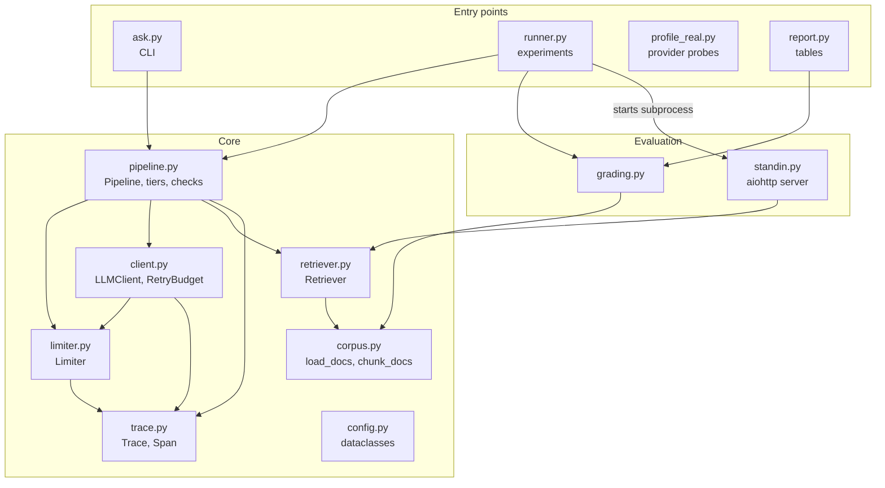
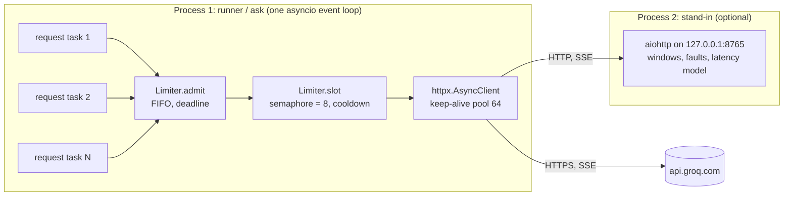
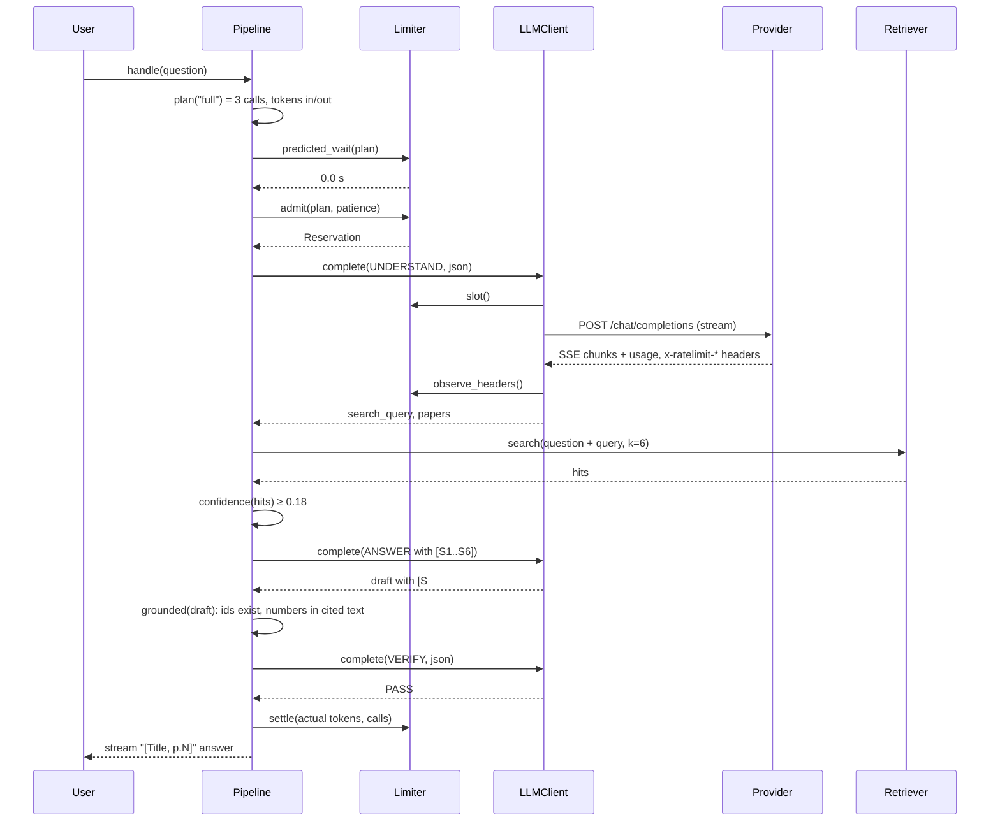

# Architecture: The Relay

Four views: components and their dependencies, the runtime (processes and concurrency), the request sequence, and the extension points.

## 1. Component view

### Dependency rules

- `config.py` and `trace.py` depend on nothing in the package.
- `corpus.py` → `retriever.py` → `pipeline.py`. Retrieval never imports anything about models.
- `limiter.py` knows nothing about HTTP; `client.py` feeds it headers and 429 bodies.
- `pipeline.py` is the only module that knows about reply modes.
- `standin.py` imports only `retriever.tokenize` (to pick sentences). It does not know the papers.
- `grading.py` and `report.py` read files. They never call a model.

## 2. Runtime view

- **One event loop, many tasks.** Each request is an `asyncio` task. Blocking work is limited to retrieval (~4 ms of pure Python), so no threads are needed.
- **Two gates in sequence.**
  1. `admit` reserves capacity for the whole request against the minute windows and the daily budget.
  2. `slot` caps concurrent HTTP calls at 8 and enforces the post-429 cooldown.
  Both gates honour the request's deadline and raise `Shed` instead of waiting past it.
- **The stand-in runs as a separate process.** `runner.StandIn` starts it with `python -m relay.standin`, and loads `raw/standin_calibration.json` into it on every reset. Scenario settings (limits, fault rates, remaining daily budget) are changed over its `/admin` HTTP endpoints, so the pipeline code is identical for real and stand-in runs.
- **Patience is enforced outside the pipeline.** `runner.fire` waits 15 s, then cancels the task and records `given_up`. Inside the pipeline, model calls stop at 80% of patience (12 s) so there is time left for the passages fallback.

## 3. Request sequence (full mode, happy path)

On a 429 the client calls `Limiter.on_429`, which records the limit kind and value and sets the shared cooldown. The client then sleeps for max(jittered back-off, `retry-after`), but only if that still fits before the deadline.

## 4. Deployment

There is no service deployment in this assignment. The intended shape for production, and what it needs:

| Concern | Today | For production |
|---|---|---|
| Process model | One process | N workers behind a queue |
| Limiter state | In memory; optional JSON file for daily counters | Shared store (Redis) with atomic reserve/settle |
| Index | Built at start-up in ~1 s | Same; rebuild on document change |
| Cache / single-flight | In process | Shared cache keyed by normalised question |
| Secrets | `.env` | Secret manager |
| Logs | JSON lines in `raw/` | Same schema shipped to a log store |

## 5. Extension points

| To change | Edit | Notes |
|---|---|---|
| Documents | Drop files into a folder; pass `--corpus` | `library.json` is optional |
| Provider | `RELAY_BASE_URL`, `RELAY_API_KEY`, `RELAY_MODEL` | Must speak OpenAI chat completions with SSE |
| Limits | `LimitsConfig` | Starting values only; corrected at runtime |
| Retrieval tool | Any object with `async search(query, k, rerank) -> list[Hit]` | `Tool` protocol in `pipeline.py`; `LocalSearchTool` is the default |
| Reply-mode thresholds | `PipelineConfig.full_wait_share`, `lean_wait_share`, `patience_s` | Shares of patience |
| Prompts | `UNDERSTAND_SYS`, `ANSWER_SYS`, `VERIFY_SYS`, `REVISE_SYS` in `pipeline.py` | `[[TASK]]` tags let the stand-in recognise the step |
