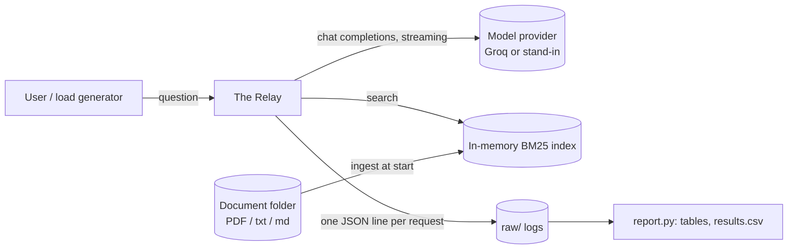
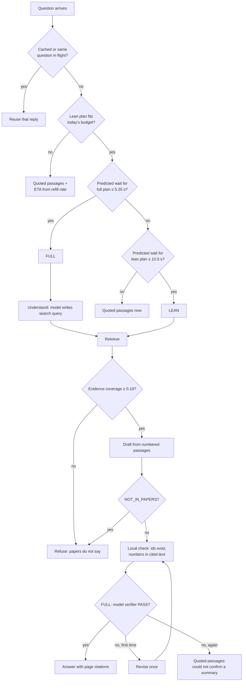

# High-Level Design: The Relay

## 1. Problem

Engineers ask questions about a small library of research papers. An assistant answers by chaining model calls and a retrieval tool. The model provider limits requests per minute, tokens per minute, requests per day and tokens per day, and those limits change without notice. Traffic arrives in bursts. Calls are sometimes slow or stall. People give up after a few seconds.

The company wants fast replies, good replies, a small bill, and nobody turned away, and it never wants a wrong answer sent just to stay fast. All four cannot hold at once under load, so the design states which one gives way.

## 2. Goals and non-goals

### Goals

| # | Goal | How it is measured |
|---|---|---|
| G1 | Never present an unsupported claim as an answer | Wrong % in Table 3; every reply passes a check before release |
| G2 | Cite every claim to a page that holds it | Grader checks the cited page text for the expected fact |
| G3 | Say "the papers do not say" when they don't | Correctly refused % on 7 unanswerable questions |
| G4 | Every person gets a reply within 15 s | Succeeded % and Given up % in Table 2b |
| G5 | Spend provider quota only where it changes the reply | Tokens per answer per scenario |
| G6 | Work on any document folder and any OpenAI-compatible provider | No paper-specific code; provider set by environment |

### Non-goals

- Multi-turn conversation. Each question stands alone.
- Multi-process or multi-host deployment (see [KNOWN_ISSUES.md](KNOWN_ISSUES.md)).
- Semantic or multilingual retrieval.
- A user interface beyond the command line and the experiment runner.

### Priority when goals conflict

1. **Correctness (G1–G3)** is never traded away.
2. **Responsiveness (G4)** comes next: a fast, weaker reply beats a slow, rich one.
3. **Richness of the reply** gives way first. Under load, users get a lean answer or quoted passages instead of a fully checked summary.
4. **Cost (G5)** follows from the above. Every reply mode uses fewer tokens than the one above it.

## 3. System context

## 4. Components

| Component | Responsibility | Module |
|---|---|---|
| Ingestion | Turn a folder of documents into page-tagged chunks; drop running headers; tag bibliography chunks | `corpus.py` |
| Retriever | BM25 search, optional light re-rank, confidence score | `retriever.py` |
| Limiter | Model all five provider limits; reserve capacity per request; learn limits from responses | `limiter.py` |
| Model client | Stream completions; classify failures; retry with back-off, budget and circuit breaker | `client.py` |
| Pipeline | Choose the reply mode; run the steps; check answers; fall back safely | `pipeline.py` |
| Tracing | Record waiting, working and retrying spans per request | `trace.py` |
| Stand-in service | A provider we control, for loads the free tier cannot take | `standin.py` |
| Experiments | Real-service probes, load scenarios, quality runs, retry experiment | `profile_real.py`, `runner.py` |
| Grading and reporting | Grade answers automatically; build every table from raw logs | `grading.py`, `report.py` |

## 5. Main flow

Every model call failure (429 with no time left, timeout, server error, stall) leads to the quoted-passages reply for that request. It never leads to an unchecked draft.

## 6. Key design decisions

The full log with evidence is [DECISIONS.md](DECISIONS.md). The decisions that define the system:

1. **Release only checked text.** First token therefore equals total time. That costs perceived speed (no streaming of drafts) and buys G1.
2. **Choose the reply mode before spending anything.** The limiter predicts the wait for the request's whole plan, so a request never starts a 3-call path it cannot finish within patience.
3. **Admit whole requests, not single calls.** A request reserves all its calls and tokens at once and settles to actual usage afterwards. Half-done requests do not stall behind newcomers.
4. **Quoted passages as the floor.** Zero tokens, about 3 ms, still cited. It replaces both "please wait" and "error".
5. **Learn the limits at runtime.** Headers and 429 wording update the limiter. That is how the hidden 7,000 input-tokens/minute cap is handled.
6. **BM25, no vector database.** Three papers full of exact identifiers; evidence recall is 92.9% with no model download.

## 7. Quality attributes

| Attribute | Approach | Evidence |
|---|---|---|
| Correctness | Local number/citation check, optional model verifier, refuse below a coverage threshold, `NOT_IN_PAPERS` contract | 7/7 unanswerable refused in all real runs |
| Latency | Mode choice by predicted wait; 5 s attempt timeout; single-flight and 5 min cache | p50 1,675 ms real steady; 3 ms in passages mode |
| Availability | Fallback to passages on any model failure; circuit breaker | 0% given up in all final runs |
| Cost | Lean mode ~550 tokens vs full ~2,000; passages 0 | Tokens per answer, Table 2b |
| Observability | Every request logged with spans, tokens, 429s, mode, grade | `raw/*.jsonl`, `results.csv` |
| Portability | Corpus-agnostic ingestion; OpenAI-compatible client | `relay.ask --corpus`, `RELAY_BASE_URL` |

## 8. Risks

| Risk | Effect | Mitigation now | Later |
|---|---|---|---|
| Users treat quoted passages as failure | Overload "success" falls from 100% to 21.7% | Passages are cited and labelled honestly | Paid tier; smaller prompts |
| Several processes share one key | Each over-spends; storms of 429s | Limiter learns usage from headers | Shared limiter store |
| Model verifier rejects correct answers | Good answers downgraded | Verifier prompt judges meaning; local check carries most of the load | Decide whether to keep the verifier (it lowered accuracy in Table 3) |
| Provider changes limits | Planned waits wrong | Limits re-read from every response | — |
